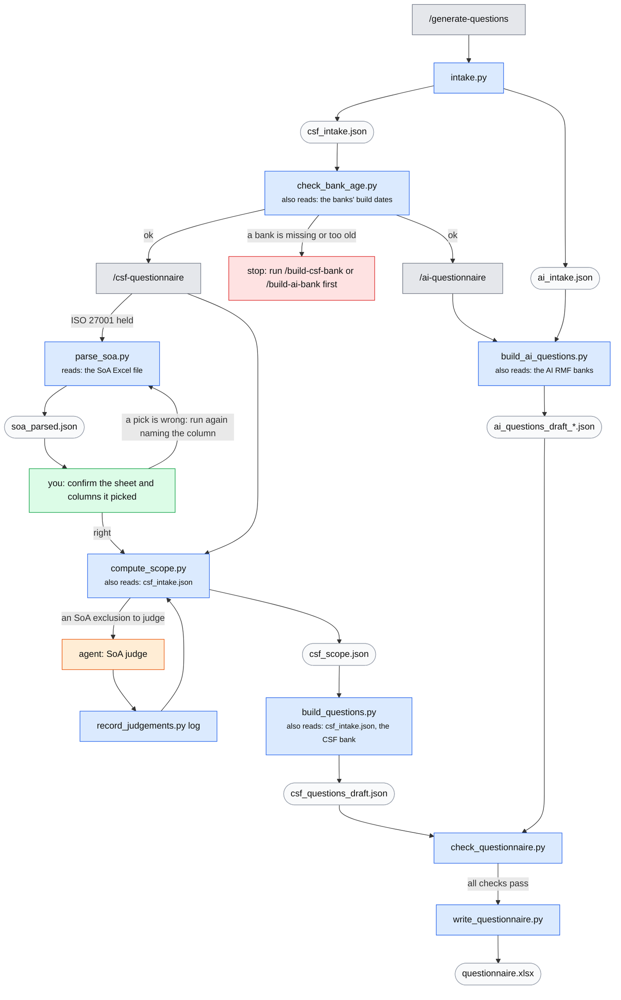
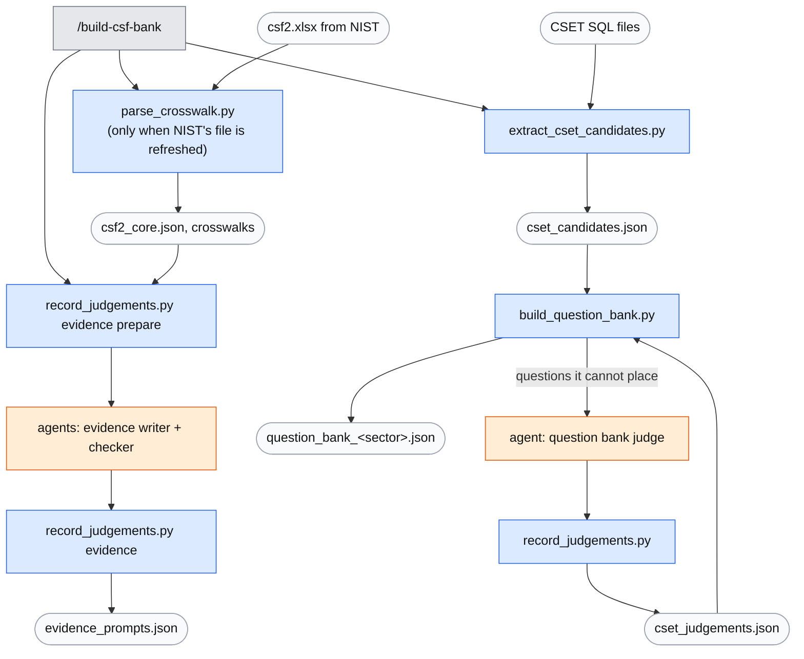
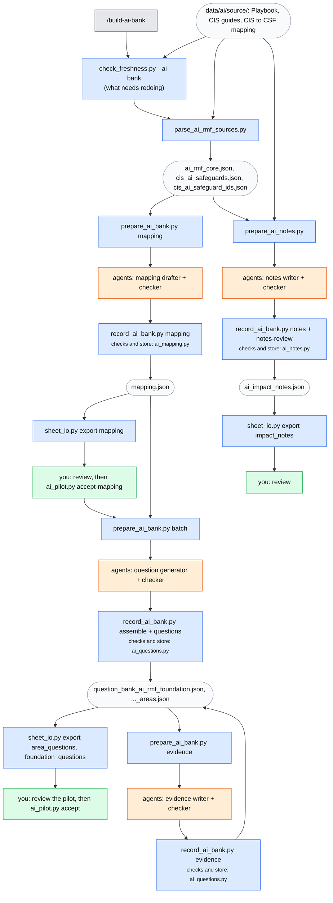

# csf-ai-self-assessment — full guide

The detail behind the short `README.md`: every command, script, data file and the glossary.

Stage 1 of an AI and cybersecurity assessment pipeline. Given an organisation's profile (domain, certifications, optional ISO 27001 SoA) it produces one questionnaire (`questionnaire.xlsx`) to send to control owners, with two sheets: a tailored NIST CSF 2.0 sheet and a NIST AI RMF 1.0 sheet scoped by how the org uses AI. The client sees one questionnaire; the two tracks are internal. In Stage 2 the answers from the two sheets become two profile XLS files (CSF profile, AI RMF profile). Rules for changing the repo are in `DESIGN_RULES.md`; `CLAUDE.md` is the short operating guide. Pipeline design: `docs/architecture.md`.

```
Question banks  →  Stage 1: Questionnaire  →  Stage 2: Answers        →  Stage 3: reports
(CSF and AI RMF    (this repo)                (later)                    (later)
 built)
```

## I want to…

| I want to… | Do this |
|---|---|
| Generate a questionnaire for a client | `/generate-questions`. It asks the intake once (numbered choices), checks the banks are recent enough (it stops if one is missing or too old, and never rebuilds), then runs the CSF and AI commands, and writes one `questionnaire.xlsx` (CSF sheet + AI RMF sheet). |
| Generate only the CSF part, or only the AI part | On an existing run folder: `/csf-questionnaire` or `/ai-questionnaire`. Each checks its questions and writes its own sheet; either can run in any order. |
| See what the bank builds need to redo (maintainer) | `.venv/bin/python ./scripts/check_freshness.py --csf` (NIST's reference data and every CSF bank against CSET) or `--ai-bank` (each part of the AI RMF build against its sources). |
| Build or refresh the CSF banks | `/build-csf-bank` (all six sectors together). `/generate-questions` stops and names it when a bank is missing or too old. |
| Build or refresh the AI RMF mapping, the question banks (foundation, areas) and the CSF AI impact notes | `/build-ai-bank`: pilot first; after you accept the pilot (`ai_pilot.py accept`) later rebuilds run on their own. |
| Use a new Playbook, CIS guide or CSF download | Replace the file (`data/ai/source/` or `data/csf/source/csf2.xlsx`, links in `data/metadata.json`). The freshness check sees the change; rebuild with the commands above. |
| Change how many questions per type, or when a question is `gap` | `data/csf/scope_rules.json` (CSF). AI: `data/ai/scope_rules.json` says which roles each client is asked as; every AI question is `full_discovery` (they ask what is done for AI, so they never repeat general security; no gap rule). No code change. |
| Change an intake menu, a domain, a certification or the question-type order | `data/common/intake_options.json`. Every script reads it through `scripts/options.py`. |
| Change the AI question roles, producer details or impacts | `data/ai/question_rules.json` (what the generator and evaluator are told, and what `record_ai_bank.py questions` checks). |
| Review the AI RMF mapping (right, wrong, missing) | `.venv/bin/python ./scripts/sheet_io.py export mapping`, open `data/ai/authoring/mapping.xlsx` (one line per AI area x subcategory, mapped or not, with the Playbook text; a Coverage sheet), edit, then `sheet_io.py import mapping`. Then accept it: `.venv/bin/python ./scripts/ai_pilot.py accept-mapping`. |
| Review the AI RMF questions | `.venv/bin/python ./scripts/sheet_io.py export area_questions` (and `foundation_questions`), open `data/ai/authoring/questions_areas.xlsx` / `questions_foundation.xlsx` (one line per question: areas covered, who it is asked of, flag, question, Playbook actions, status), edit, then `sheet_io.py import area_questions`. Changed subcategories are stored as decided by a person and a later generator run does not overwrite them. |
| Review the CSF AI impact notes | `.venv/bin/python ./scripts/sheet_io.py export impact_notes`, open `data/ai/authoring/impact_notes.xlsx` (one line per CSF subcategory: exposure note, the two use notes, status from the notes evaluator), edit, then `sheet_io.py import impact_notes`. Changed lines are stored as decided by a person. |
| Change the AI areas (usage and ecosystem components, their impact) | Edit `data/ai/authoring/ai_areas.xlsx` (the decision), then `.venv/bin/python ./scripts/sheet_io.py import ai_areas` (checks every row, writes `data/ai/ai_areas.json`). The model is in `docs/ai-rmf-model.md`. A change to an area makes its mapping rows, and then their questions, out of date. |
| Change how an agent judges | The file in `prompts/` (see the list below). Editing the AI generator or evaluator prompt makes the accepted pilot stale. |
| See what happened in a run | `runs/<Org>_<date>/audit.jsonl` (timeline) and `judgement_log/` (what each agent was shown and answered). |
| Change the code or add a stage | Read `DESIGN_RULES.md` first, then run the tests (`.venv/bin/python -m unittest discover -s tests`). |

## How it works

- **Scripts do the repetitive, deterministic work and never decide.** Parsing, joining, looking up, validating, formatting. This is what keeps agent token use low.
- **Agents do every judgement**, and see only the small set of items a script could not settle (a `pending` file, exit code 2).
- **Everything that happens in a run is audited.** Each script run and agent step appends one line to an `audit.jsonl` (who, what, inputs and outputs with hashes, how it ended). Agent judgements also get a full write-once record in `judgement_log/` (model, prompt hash, output snapshot). Any new script or stage should use the same helper, `scripts/audit.py`.
- **Policy and content live in data files, not code.** To change a rule or a wording, edit a JSON file.

## Setup

- Python 3. Create the project venv once: `python3 -m venv .venv && .venv/bin/pip install -r requirements.txt` (`openpyxl`, `pdfplumber`). Every command in this guide runs as `.venv/bin/python ./scripts/<script>.py`.
- GitHub Codespaces: `.devcontainer/devcontainer.json` creates the venv and installs the requirements when the codespace is created (Python 3.12, Node for the Claude Code CLI). The licensed sources in `data/ai/source/` are not in the repo; upload them to the codespace if you need to re-parse.
- The AI RMF sources (Playbook, CIS companion guides, CIS to CSF mapping) are not in the repo; see `data/ai/source/README.md`.
- A copy of the public CSET repo at `~/workstuff/cset`, only for building and checking the CSF banks (an assessment does
  not need it). `/build-csf-bank` clones it the first time it runs. To clone it yourself, take only the SQL folder with
  full history (the freshness check compares commits; ~370 MB):
  `mkdir -p ~/workstuff && git clone --filter=blob:none --sparse https://github.com/cisagov/cset.git ~/workstuff/cset && git -C ~/workstuff/cset sparse-checkout set CSETWebApi/CSETWeb_Api/CSETWebCore.UpgradeLibrary/VersionUpgrader/SQL`
- Run everything from the repo root, inside Claude Code.

## Commands

| Command | What it does |
|---|---|
| `/generate-questions` | The whole flow: intake (numbered choices) → bank age check (stops if a bank is missing or too old) → `/csf-questionnaire` → `/ai-questionnaire` → one `questionnaire.xlsx`. Stops at the SoA question and to confirm the SoA columns. Send the XLSX to control owners. |
| `/csf-questionnaire` | The CSF sheet for a run folder: SoA question (and confirming its columns), scope, questions from the bank, check, sheet. Writes `csf_scope.json`, `csf_questions_draft.json` and the CSF sheet of `questionnaire.xlsx`. |
| `/ai-questionnaire` | The AI RMF sheet for a run folder: picks the client's questions by role, producer details and AI areas from `ai_intake.json`, checks them, writes the sheet. Writes `ai_scope.json`, `ai_questions_draft_<foundation|areas>.json` and the AI RMF sheet of `questionnaire.xlsx`. |
| `/build-csf-bank` | Builds the six CSF question banks, all sectors together, from the CSET repo (occasional; reused by every engagement). |
| `/build-ai-bank` | Builds the AI RMF mapping (AI area x subcategory), the two question banks (foundation, areas) and the CSF AI impact notes from the Playbook and CIS companion guides (quarterly, or when a source changes). Pilot first, then full run. |

The intake is `scripts/intake.py`: it prints the numbered menus (from `data/common/intake_options.json`), turns the typed numbers into values, and writes `csf_intake.json` (org, domain, certs) and `ai_intake.json` in the run folder. Every later step reads those files.

**Not built yet:** Stage 2 (answers → the two profile spreadsheets, including writing the AI impact notes into the CSF profile's Considerations column) and Stage 3 (reports). The AI RMF banks and notes are built by `/build-ai-bank`; both banks are in `data/ai/banks/`.

### Building a bank (`/build-csf-bank`)

1. `extract_cset_candidates.py` replays the CSET SQL migrations into `cset_candidates.json` (skipped if CSET has not changed): CSET's own CSF 2.0 set (`NCSF_V2`, one question for each of the 106 subcategories) and the maturity-model questions (ACET, CPG, SSG…) CSET maps to CSF 2.0.
2. `build_question_bank.py` puts the CSF 2.0 set's question first in every subcategory (no routing), then routes each maturity-model question for each sector: **reject** (not answerable or empty), **accept** (source model matches the domain), or **pending**. The routing rules are in `data/csf/bank_rules.json`.
3. If anything is pending the agent decides it using `prompts/question_bank_judge.md`: which domains a question suits, rewording statements and repairing truncated text, and whether a widely-mapped question fits each subcategory. `record_judgements.py` validates and stores the verdicts (reused by every domain, redone only when CSET changes a question).
4. Run the build again; it writes all six `data/csf/banks/question_bank_<sector>.json` together (no bank is written while anything is pending, so the six always share one record of what they were built from).
5. Once for all domains: each subcategory's own evidence prompt (`record_judgements.py evidence`, writer and evaluator
   agents, `data/csf/evidence_prompts.json` `by_subcategory`); a subcategory without one keeps its category's line.

Domains: `healthcare`, `finance`, `manufacturing_ot`, `saas_cloud`, `consulting`, `other`.

### Running an engagement (`/generate-questions`)

1. `intake.py` asks once, as numbered choices: org, domain, certs, the AI usage profile (AI in use none / some / unsure, then "How do you use AI?" and "What does your AI include?", which give the client's AI areas), and for an organisation that builds its own model the two producer details. It writes `csf_intake.json` (org, date, sector, certifications: the CSF sheet is picked from these) and `ai_intake.json` (the AI answers: the AI RMF sheet is picked from these); every later step reads them.
2. `check_bank_age.py --run <run>` checks the build date of the CSF bank of the domain and the two AI RMF banks against the limits in `data/metadata.json` (`question_banks`: CSF 365 days, AI 90). If a bank is missing or too old the run stops and names the command to rebuild it (`/build-csf-bank`, `/build-ai-bank`); a client run never rebuilds a bank. It needs no source files.
3. `/csf-questionnaire`: `parse_soa.py <run> <soa>` extracts the SoA and prints the sheet and columns it picked; the user confirms them (a wrong pick is corrected with `--sheet` / `--id-col` / ...). If any excluded control needs reading, `compute_scope.py` exits 2 and the agent classifies it with `prompts/soa_exclusion_judge.md`. `compute_scope.py` gives each subcategory a type: `full_discovery`, `gap` (cert covers it, ask what goes beyond), `confirmatory` (cert should cover it, ask for evidence) or `skip`; policy is in `data/csf/scope_rules.json`. `build_questions.py` picks questions from the bank and words them for the certs held, producing `csf_questions_draft.json`.
4. `/ai-questionnaire`: see below.
5. Each of the two commands ends with `check_questionnaire.py`, which checks the picked questions against the intake and the banks (nothing missing, right question types and flags, every question from the bank, nothing for a role, AI area or certification the org does not have). Only if it passes does `write_questionnaire.py` write that framework's sheet of `questionnaire.xlsx` (each replaces only its own sheet). Questions are reviewed once, when the banks are built, never per run.

### AI RMF track

**Building the banks (`/build-ai-bank`):**
1. `check_freshness.py --ai-bank` compares the SHA-256 of the current source files with the hashes each output recorded about its inputs, one line per stage; all current means skip.
2. `parse_ai_rmf_sources.py` turns the Playbook and the three CIS guides into `ai_rmf_core.json` (the 4 functions with their Playbook descriptions, 72 subcategories, suggested actions) and `cis_ai_safeguards.json` (153 safeguards per guide, with the CIS text: local only, CC BY-NC-ND 4.0) plus `cis_ai_safeguard_ids.json` (the same without text: committed).
3. Mapping (agents, `prompts/ai_rmf_mapping_drafter.md` and `ai_rmf_mapping_evaluator.md`): per AI area (`data/ai/ai_areas.json`), the MAP, MEASURE and MANAGE subcategories that check it and the CIS safeguards that prove them, recorded by `record_ai_bank.py mapping` against `data/ai/mapping_rules.json`, reviewed in `mapping.xlsx` and accepted (`ai_pilot.py accept-mapping`).
4. Questions, generated and evaluated with subagents (`prompts/ai_rmf_question_generator.md`, `prompts/ai_rmf_question_evaluator.md`), two turns at most, into two banks: **foundation** (GOVERN and the 12 foundation subcategories, asked once for the organisation) and **areas** (one item per subcategory with every area's mapping row on it; a question may stand for several rows). Every question carries the roles it is asked of and any producer details it needs. `prepare_ai_bank.py batch <foundation|areas>` prepares each batch; `record_ai_bank.py assemble` and `questions` store the result (every row asked once, or twice when its check holds two practices, per role its area allows). Pilot first; when the user accepts it (`ai_pilot.py accept`, tied to the current generator and evaluator prompts) later rebuilds run without asking, like the CSF banks.
5. AI impact notes: `prepare_ai_notes.py` joins the CIS → CSF mapping to the MCP and agents guides (48 CSF subcategories); an agent writes an exposure layer and a use layer (`prompts/ai_impact_notes_writer.md`); `record_ai_bank.py notes` stores `data/csf/ai_impact_notes.json`; a second agent reviews them (`prompts/ai_impact_notes_evaluator.md`, `record_ai_bank.py notes-review`).

**Running an engagement (`/ai-questionnaire`, run by `/generate-questions` or alone):** `build_ai_questions.py` picks the client's questions from both banks by filtering on `ai_intake.json`: roles (`scope_rules.json` `client_roles`), producer details and, for area questions, the client's AI areas. A question shared by several of the client's areas carries "This question covers: ..." naming them. Every question is `full_discovery`: it asks what is done for AI, so it never repeats the CSF sheet or ISO 27001. It writes one draft per bank. `check_questionnaire.py` checks them and `write_questionnaire.py --framework ai` writes the AI RMF sheet of `questionnaire.xlsx`, plus an "AI systems" sheet where the client answers the inventory question (GOVERN 1.6) as a table: one row per system, which of the client's AI areas it involves, and its criticality. The layout comes from `templates/questionnaire_template.xlsx`.

## What is where

### Scripts

You run commands; each command runs its scripts in order. Scripts do the routine work and never make judgement calls:
where one is needed, an AI agent makes it and a script checks the answer before storing it.

How to read the diagrams: grey boxes are commands, blue are scripts, orange are AI agents, green is you, red is where
a run stops, and the rounded boxes are the files they read or write.

**Making a questionnaire** (`/generate-questions`)



**Building the CSF banks** (`/build-csf-bank`, maintainer)



**Building the AI RMF banks** (`/build-ai-bank`, maintainer)



`sheet_io.py import` takes your edits from any review spreadsheet back into the data (lines you change are never
overwritten by an agent). Each script's own file opens with a short explanation of what it does.

**Helpers** (used by the scripts above, never run directly): `paths.py` (where every file lives), `options.py` (shared
lists: sectors, certifications, question types), `audit.py` (the run log), `ai_bank_common.py` (shared AI bank
helpers), `ai_mapping.py`, `ai_questions.py` and `ai_notes.py` (the checks, storing and review sheets behind
`record_ai_bank.py` and `sheet_io.py`, one file per kind of AI bank data), `ai_priority.py` (priorities for Stage 2; not used yet).

### Prompts (`prompts/`)

How the agents judge and write. CSF: `question_bank_judge.md`, `csf_evidence_writer.md`, `csf_evidence_evaluator.md` (bank build), `soa_exclusion_judge.md` (client run). AI RMF: `ai_rmf_mapping_drafter.md`, `ai_rmf_mapping_evaluator.md`, `ai_rmf_question_generator.md`, `ai_rmf_question_evaluator.md`, `ai_rmf_evidence_writer.md`, `ai_rmf_evidence_evaluator.md`, `ai_impact_notes_writer.md`, `ai_impact_notes_evaluator.md` (bank build). Commands (`.claude/commands/`) say what to run; prompts say how to judge.

### Data (`data/`)

Not written during an engagement; that output goes to `runs/`.

```
data/
├── metadata.json            source, last refresh and staleness threshold per file
├── tier_definitions.json    NIST Tier 1-4 (not used yet; needed to map answers to tiers)
├── common/
│   ├── intake_options.json  intake menus, domains, certs, question types (shared by both tracks)
│   └── sheet_specs.json     columns and allowed values of every spreadsheet sheet_io.py converts
├── csf/
│   ├── source/csf2.xlsx     NIST CPRT export (refreshed about yearly)
│   ├── csf2_core.json       CSF 2.0 subcategories and examples
│   ├── scope_rules.json     state → question type, max questions per type, domain bump, function order; how
│   │                        the SoA spreadsheet is read (soa_reading)
│   ├── bank_rules.json      how CSET questions are flagged and routed when a CSF bank is built: sector of each
│   │                        question set, reject and rewrite flags, the fan-out threshold
│   ├── domain_weights.json  per-sector priorities
│   ├── evidence_prompts.json  evidence hint per CSF category
│   ├── crosswalks/          ISO 27001 and PCI DSS mappings
│   ├── banks/               question_bank_<domain>.json
│   └── bank_build/          cset_candidates.json, cset_judgements.json (cannot be regenerated; back it up), judgement_log/, audit.jsonl
├── audit.jsonl              data refresh and freshness checks (created on first run)
└── ai/
    ├── source/                 AI RMF Playbook, CIS companion guides, CIS → CSF mapping (not in the repo; see source/README.md; SHA-256 in metadata.json)
    ├── parse_config.json       expected counts and file names for the parser; the AI text length for impact notes
    ├── ai_rmf_core.json        4 functions (Playbook description) with their 72 subcategories + suggested actions (parsed)
    ├── cis_ai_safeguard_ids.json  safeguards of the three guides: ids, controls, IG (committed)
    ├── cis_ai_safeguards.json  the same with the CIS text (parsed, local only, not committed)
    ├── question_rules.json     question banks: roles, producer details, impacts, question counts, the AI systems sheet,
    │                           text length limits
    ├── area_client_labels.json what the client sees for each AI area (area id -> plain label)
    ├── authoring/ai_areas.xlsx  AI areas and their impact, decided by a person (sheet_io.py import -> ai_areas.json)
    ├── ai_areas.json           generated from authoring/ai_areas.xlsx; scripts read this
    ├── mapping_rules.json      candidate CIS controls per AI area, required checks, foundation subcategories
    ├── mapping.json            AI area x function -> subcategory, CIS safeguards, impact (record_ai_bank.py mapping)
    ├── authoring/mapping.xlsx  the mapping for review (sheet_io.py export mapping; edits back with import mapping)
    ├── authoring/questions_<areas|foundation>.xlsx  the question banks for review (sheet_io.py export area_questions / foundation_questions)
    ├── scope_rules.json        engagement policy: AI area rules for the intake, roles each client is asked as, notes
    ├── evidence_prompts.json   evidence hint per question (foundation, or by the impacts of the rows it covers)
    ├── banks/                  question_bank_ai_rmf_<foundation|areas>.json
    └── bank_build/             audit.jsonl, pending/work files, judgement_log/ (write-once records of agent steps)
```

### Runs (`runs/<Org>_<date>/`)

One folder per engagement. It holds client data, so keep it out of any shared repo.

| File | What |
|---|---|
| `inputs/soa_original.xlsx` | Client SoA (if provided) |
| `soa_parsed.json`, `soa_pending.json`, `soa_judgements.json` | Parsed SoA, controls needing a reading, the agent's classifications |
| `csf_intake.json` | Org, date, domain, certifications (from `intake.py`; read by scope, question building and the freshness check) |
| `ai_intake.json` | The AI usage profile (AI in use, role, producer details, the client's AI areas), from the same intake |
| `csf_scope.json` | Question type per subcategory, with the reason |
| `ai_scope.json`, `ai_questions_draft_<bank>.json` | The AI RMF track for the run (scope, the picked questions per bank); the AI RMF sheet goes into `questionnaire.xlsx` |
| `csf_question_bank_used.json`, `csf_questions_draft.json` | Copy of the CSF bank used, the picked CSF questions |
| `ai_question_bank_used_<bank>.json` | Copies of the two AI RMF banks used |
| `questionnaire.xlsx` | The deliverable workbook with the CSF sheet and the AI RMF sheet |
| `audit.jsonl` | Timeline of the whole run: every script and agent step, with status (`ok`, `pending`, `rejected`, `error`, `incomplete`), file hashes and the intake answers (domain, certs) |
| `judgement_log/` | Full write-once record of each agent step (model, prompt hash, output snapshot) |

### Tests

`tests/fixtures/` has `sample_soa.xlsx`. `templates/` has `questionnaire_template.xlsx`, the questionnaire layout each run copies and fills (change its look in Excel), and the two empty profile XLS files that Stage 2 fills (a copy per run, in the run folder, never committed): `csf_org_profile_template.xlsx` (NIST's CSF 2.0 Organizational Profile template, emptied; source in `data/metadata.json`: sheet "Current and Target Profile", 19 columns, the CSF ids and outcomes, NIST's column descriptions) and `ai_rmf_profile_template.xlsx` (sheet "AI RMF Profile", 11 columns, the AI RMF ids and outcomes). Both carry only headers, ids and outcome text; keep their cell colours (the framework colours). `.venv/bin/python -m unittest discover -s tests` checks the scripts: the intake, the SoA reader, scope, both question pickers, the questionnaire check and writer, the AI RMF build scripts and the review sheets (stores redirected to a temp dir, so the tests never change `data/`).

## Status

- **Stage 1 is built.** CSF banks for all six sectors, built from CISA's CSET (every subcategory starts with CSET's own
  CSF 2.0 question). AI RMF: the sources are parsed (72 subcategories, 459 safeguards), the AI areas, intake and
  mapping are built and the mapping is approved, and both question banks (foundation, areas) are built and reviewed.
- The client run has been tested end to end with the scripts (tests and scratch runs); a run with a real organisation
  has not been done yet.
- Stage 2 (answers → profile spreadsheets) is next; Stage 3 (reports) after it (`TODO.md`).

## Glossary

| Term | Meaning |
|---|---|
| **Bank** | A frozen set of questions, built once and reused. CSF: one per domain, from CSET (candidate questions). AI RMF: two, foundation and areas, generated from the Playbook and CIS guides; they hold every possible question, each tagged with the roles it is asked of. A questionnaire picks from a bank; it never invents questions. |
| **AI area** | A way AI is used (internal process, code generation, customer-facing, vendor AI, model building, invisible usage) or a part of the AI ecosystem (input, output, test, tuning and evaluation data, model, source data, MCP / tools, agent, hosting). 14 in all, decided by a person in `data/ai/authoring/ai_areas.xlsx`. |
| **Mapping row** | One AI area x one AI RMF subcategory (MAP, MEASURE or MANAGE): why that subcategory matters for the area, its impact, and the CIS safeguards that can serve as evidence. Area questions are written per row. All rows together are the **mapping** (`data/ai/mapping.json`). |
| **Foundation** | GOVERN and 12 other subcategories about how the organisation runs AI risk management: asked once for the organisation, never per area. |
| **Question type** | Set per subcategory at engagement time. `full_discovery`: nothing is covered, ask everything. `gap`: a certification covers the standard part, ask what goes beyond it. `confirmatory`: a certification should cover it, ask for evidence. `skip`: not asked. Every AI RMF question is `full_discovery`: it asks about AI, so certifications change nothing there. |
| **Domain** | The client's sector for the CSF bank: healthcare, finance, manufacturing_ot, saas_cloud, consulting, other. |
| **SoA** | The client's ISO 27001 Statement of Applicability. It sets CSF question types for ISO-mapped subcategories. |
| **AI in use** | `none`, `some` or `unsure`. `unsure` is asked as a consumer and as an org with no AI; the questions discover what AI is used. `none` gets the AI policy and shadow-AI questions only. |
| **Producer / consumer** | Consumer: uses AI built by others (a vendor model, an API, AI inside products). Producer: builds or tunes its own model, from scratch or on an existing model, for itself or to give to others. Each question is tagged with the roles it is for; an organisation can be both. |
| **Producer details** | Two follow-up answers for an organisation that builds its own model: is it built on an existing model (then it gets questions about that base model), and is it given to others (then it gets questions about releasing it). Stored as `producer_flags` in the data. |
| **Covers note** | "This question covers: ..." on an area question that stands for several of the client's areas, naming only the client's own areas. |
| **Impact** | What could go wrong if an AI area is handled badly: `process` (a business process or decision goes wrong), `data` (data exposed, leaked or poisoned), `access` (permissions or credentials abused), `assets` (model, code or infrastructure stolen or damaged), `people` (harm to individuals). Each AI area and mapping row carries one or more; they shape the evidence asked for. Defined in `data/ai/question_rules.json`. |
| **Folded subcategory** | A subcategory that would get the same question as another row of the same AI area, so it is merged into that row instead of getting its own. The row's question must cite it. |
| **Required check** | A subcategory the rules say certain AI areas must always map, for example an audit trail and incident response for every area (`data/ai/mapping_rules.json` `required_checks`). |
| **Candidate CIS safeguards** | The CIS safeguards an AI area is allowed to cite as evidence (`data/ai/mapping_rules.json` `area_cis`). |
| **Generator / evaluator** | In the bank build one agent writes (questions, mapping rows, notes) and a second, separate agent checks the result. One revision round at most; what still fails goes to a person. |
| **Needs human review** | An item the evaluator still failed after the revision round. It is kept, marked `needs_human_review`, and a person decides it in the review sheet. |
| **Decided by a person** | A line you changed in a review sheet (`decided_by: human`). Later agent runs never overwrite it. |
| **Review sheet** | A spreadsheet in `data/ai/authoring/` for checking or editing the mapping, the questions or the impact notes (`sheet_io.py export` / `import`). |
| **Pending file / exit 2** | A script that cannot settle an item writes a `pending_*.json` and exits 2; an agent decides it and a recording script stores the answer. |
| **Recording** | Validating an agent's output file as a whole, storing it, and writing a write-once log of who decided what. A bad file is rejected and nothing is stored. |
| **Pilot** | A first AI bank run on a few hand-picked subcategories, reviewed by a person. Accepting it (`ai_pilot.py accept`) approves the question generator and evaluator prompts; while they are unchanged, later rebuilds run without asking. |
| **Stale / incomplete** | Freshness report words. Stale: built from sources that have since changed. Incomplete: not every subcategory is in the bank yet (AI areas bank: or a mapping row changed after its questions were written). |
| **Run folder** | `runs/<Org>_<date>/`: everything one engagement produced. It holds client data. |
| **Profile XLS (Stage 2)** | The spreadsheet built from the answered questionnaire, one for CSF and one for AI RMF, with maturity scores. Not built yet. |
| **CSET, OLIR, Playbook, CIS guides** | CSET: CISA's assessment tool whose SQL holds the CSF questions: its CSF 2.0 standard (`NCSF_V2`, one per subcategory) and maturity-model questions mapped to CSF 2.0. OLIR: NIST's mappings between frameworks (ISO 27001 and PCI DSS to CSF). Playbook: the AI RMF's suggested actions. CIS guides: the CIS Controls v8.1 AI companion guides (LLM, MCP, agents). |
